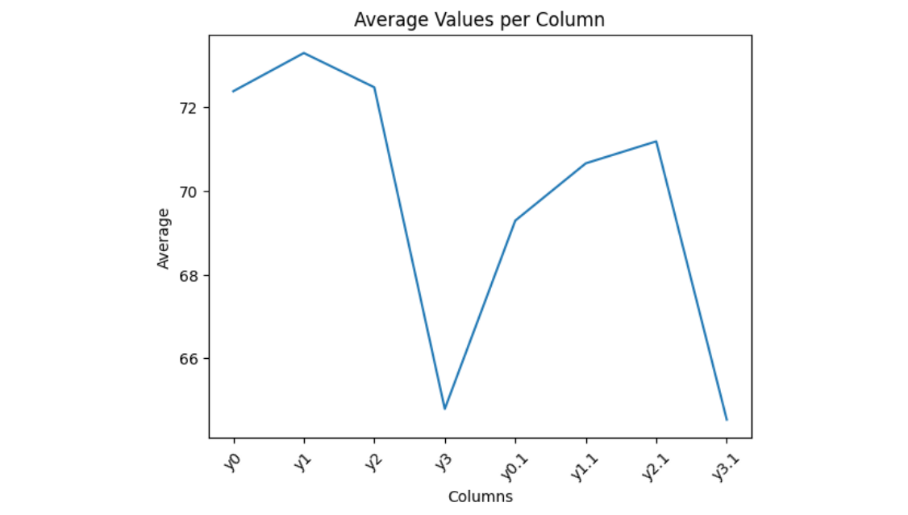

```{r}
#| label: setup
#| include: false

# Load all packages
library(ggplot2)
library(dplyr)
library(tidyr)
library(knitr)
library(readr)

```

# Diamonds Table of Statistics

```{r}
#| label: clean-diamonds
#| include: false

# Load the diamonds data
diamondsData <- diamonds

# Clean the diamonds data
diamondsClean <- diamondsData |>
  select(cut, x, y, z) |>
  filter(x > 0, y > 0, z > 0)

```

## Length

```{r}
#| label: tbl-diamond-length
#| tbl-cap: "Descriptive Statistics of Diamond Length by Cut (mm)"
#| tbl-pos: H

# Calculate length statistics by cut quality
lengthTable <- diamondsClean |>
  group_by(cut) |>
  summarize(
    Count = n(),
    Minimum = min(x),
    Quintile1 = quantile(x, 0.20),
    Quintile2 = quantile(x, 0.40),
    Median = median(x),
    Quintile3 = quantile(x, 0.60),
    Quintile4 = quantile(x, 0.80),
    Maximum = max(x),
    Mean = mean(x),
    SD = sd(x),
    .groups = "drop"
  )

# Display the length table
lengthTable |>
  kable(
    digits = 2,
    col.names = c(
      "Cut", "Freq.", "0%", "20%", "40%",
      "Median", "60%", "80%", "100%", "Mean", "SD"
    )
  )

```

As shown in @tbl-diamond-length, diamonds with Fair cut have the highest mean length of 6.25 mm, while diamonds with Ideal cut have the lowest mean length of 5.51 mm. Premium cut diamonds have the highest standard deviation, which means their lengths vary more than those in other groups. These results suggest that a higher cut quality does not necessarily mean a longer diamond.



## Width

```{r}
#| label: tbl-diamond-width
#| tbl-cap: "Descriptive Statistics of Diamond Width by Cut (mm)"
#| tbl-pos: H

# Calculate width statistics by cut quality
widthTable <- diamondsClean |>
  group_by(cut) |>
  summarize(
    Count = n(),
    Minimum = min(y),
    Quintile1 = quantile(y, 0.20),
    Quintile2 = quantile(y, 0.40),
    Median = median(y),
    Quintile3 = quantile(y, 0.60),
    Quintile4 = quantile(y, 0.80),
    Maximum = max(y),
    Mean = mean(y),
    SD = sd(y),
    .groups = "drop"
  )

# Display the width table
widthTable |>
  kable(
    digits = 2,
    col.names = c(
      "Cut", "Freq.", "0%", "20%", "40%",
      "Median", "60%", "80%", "100%", "Mean", "SD"
    )
  )

```

As shown in @tbl-diamond-width, Fair cut diamonds have the highest mean width of 6.19 mm, while Ideal cut diamonds have the lowest mean width of 5.52 mm. Premium cut diamonds have a maximum width of 58.90 mm, which is much higher than their median of 6.06 mm. This may indicate an outlier or a measurement error. Therefore, the median may better represent the typical width of diamonds in this group.

## Depth

```{r}
#| label: tbl-diamond-depth
#| tbl-cap: "Descriptive Statistics of Diamond Depth by Cut (mm)"
#| tbl-pos: H

# Calculate depth statistics by cut quality
depthTable <- diamondsClean |>
  group_by(cut) |>
  summarize(
    Count = n(),
    Minimum = min(z),
    Quintile1 = quantile(z, 0.20),
    Quintile2 = quantile(z, 0.40),
    Median = median(z),
    Quintile3 = quantile(z, 0.60),
    Quintile4 = quantile(z, 0.80),
    Maximum = max(z),
    Mean = mean(z),
    SD = sd(z),
    .groups = "drop"
  )

# Display the depth table
depthTable |>
  kable(
    digits = 2,
    col.names = c(
      "Cut", "Freq.", "0%", "20%", "40%",
      "Median", "60%", "80%", "100%", "Mean", "SD"
    )
  )

```

As shown in @tbl-diamond-depth, Fair cut diamonds have the highest mean depth of 3.99 mm, while Ideal cut diamonds have the lowest mean depth of 3.40 mm. This follows a similar pattern to the length and width results. However, cut quality alone does not explain the size of a diamond. Other factors, such as carat weight, may also affect its physical dimensions.

# Big 10 Academic Alliance

```{r}
#| label: clean-btaa
#| include: false

# Load basketball data
teams <- read_csv(
  "NCAA Women's Basketball Data Files 2026/teams.csv"
)

games <- read_csv(
  "NCAA Women's Basketball Data Files 2026/team_box.csv"
)

# Calculate average points by team
bigTenData <- games |>
  filter(season == 2026) |>
  inner_join(teams, by = "team_id") |>
  filter(conference_name == "Big Ten Conference") |>
  group_by(short_name) |>
  summarise(
    average_points = mean(team_score, na.rm = TRUE)
  ) |>
  arrange(desc(average_points))

```

```{r}
#| label: fig-btaa
#| fig-cap: "Average Points per Game for Big Ten Women's Basketball Teams"
#| fig-alt: "Horizontal bar chart of 18 Big Ten teams ranked by average points per game, with UCLA highest and Rutgers lowest."
#| fig-pos: H
#| fig-width: 6
#| fig-height: 5

# Create a horizontal bar chart
ggplot(
  data = bigTenData,
  mapping = aes(
    x = average_points,
    y = reorder(short_name, average_points)
  )
) +
  geom_col(fill = "steelblue") +
  geom_text(
    mapping = aes(label = round(average_points, 1)),
    hjust = 1.1,
    color = "white",
    size = 3
  ) +
  labs(
    title = "Big Ten Women's Basketball Scores",
    subtitle = "2026 Season",
    x = "Average Points per Game",
    y = "Team"
  ) +
  theme_classic()

```

As shown in @fig-btaa, the top five Big Ten women's basketball teams have similar average scores. UCLA has the highest average with 83.9 points per game, while Rutgers has the lowest with 58 points. Penn State is in the middle with 74.4 points per game. However, scoring more points does not always mean a team is better. Defense and the strength of opponents are also important. This graph helps us compare scoring performance, but it does not show the overall performance of each team.

# Monte Carlo Numerical Integration

```{r}
#| label: monte-carlo-function
#| include: false

# Generate random points within the given bounds
simulatePoints <- function(n, xMin, xMax, yMin, yMax) {

  x <- runif(n, min = xMin, max = xMax)
  y <- runif(n, min = yMin, max = yMax)

  points <- data.frame(x, y)

  return(points)
}

```

```{r}
#| label: monte-carlo-data
#| include: false

# Make the simulation reproducible
set.seed(184)

# Generate 10000 random points
myPoints <- simulatePoints(10000, -4, 4, 0, 0.4)

# Calculate the area of the rectangle
rectangleArea <- (4 - (-4)) * (0.4 - 0)

# Identify points below the curve and estimate the area
myPoints <- myPoints |>
  mutate(
    below = y <= dnorm(x, mean = 0, sd = 1),
    pointNumber = row_number(),
    estimatedArea = cumsum(below) / pointNumber * rectangleArea
  )

```

```{r}
#| label: monte-carlo-plots
#| include: false

# Create a reusable plotting function
makeIntegrationPlot <- function(n) {

  plotData <- myPoints |>
    slice_head(n = n)

  plot <- ggplot(
    data = plotData,
    mapping = aes(x = x, y = y)
  ) +
    geom_point(
      mapping = aes(color = below, shape = below),
      size = 1
    ) +
    stat_function(
      fun = dnorm,
      args = list(mean = 0, sd = 1),
      xlim = c(-4, 4),
      color = "black"
    ) +
    scale_x_continuous(
      limits = c(-4, 4),
      expand = expansion()
    ) +
    scale_y_continuous(
      limits = c(0, 0.4),
      expand = expansion()
    ) +
    scale_color_manual(
      values = c("FALSE" = "#999999", "TRUE" = "#1E407C")
    ) +
    labs(
      title = paste("n =", n),
      subtitle = paste(
        "Estimated Area:",
        round(myPoints$estimatedArea[n], 4)
      ),
      x = "x",
      y = "y"
    ) +
    theme_bw() +
    theme(legend.position = "none")

  return(plot)
}

# Create plots at four resolutions
plot10 <- makeIntegrationPlot(10)
plot100 <- makeIntegrationPlot(100)
plot1000 <- makeIntegrationPlot(1000)
plot10000 <- makeIntegrationPlot(10000)

```

```{r}
#| label: fig-monte-carlo
#| fig-cap: "Monte Carlo Numerical Integration of the Normal Distribution"
#| fig-subcap:
#|   - "10 points"
#|   - "100 points"
#|   - "1000 points"
#|   - "10000 points"
#| fig-alt:
#|   - "Normal density curve with 10 simulated points."
#|   - "Normal density curve with 100 simulated points."
#|   - "Normal density curve with 1000 simulated points."
#|   - "Normal density curve with 10000 simulated points."
#| layout-ncol: 2
#| fig-width: 4
#| fig-height: 3
#| fig-pos: H

# Display the four simulation plots
plot10
plot100
plot1000
plot10000

```

The Monte Carlo method estimates the area under a curve using randomly generated points. In this simulation, the rectangular area is $8 \times 0.4 = 3.2$. I calculated the proportion of points on or below the normal distribution curve and multiplied it by 3.2 to estimate the integral.

As shown in @fig-monte-carlo, the blue triangles represent points on or below the curve, while the gray circles represent points above it. The estimated areas are 0.9600, 0.8960, 0.9408, and 0.9930. Although the estimates do not always improve as the number of points increases, the largest simulation gives the closest result to 1.

I believe the integral is very close to 1 because almost all of the area under the standard normal distribution lies between -4 and 4. The actual area within this range is approximately 0.99994. In @fig-monte-carlo-4, the 10000 points provide a clearer picture of the area under the curve and support my conclusion.

# Planning and Prompting GenAI Tools

## Data Context

The calcium data come from a study of 31 women over four years. There are 15 women in the null treatment group and 16 women in the diet and exercise group. Each woman had her ulnar calcium measured at four different times: Initial, Year 1, Year 2, and Year 3.

The original data are not tidy because the two treatment groups and measurement times are stored in different columns. The data need to be organized before creating a visualization.

## Plan

### Goal

Tidy and wrangle the calcium data and create a line graph to compare how calcium measurements change over time between the two treatment groups.

### Needs

- R and RStudio
- Original calcium.csv file
- readr package
- dplyr package
- tidyr package
- ggplot2 package

### Steps

1. Load all required packages.
2. Read the original calcium.csv file.
3. Check the structure, column names, and missing values.
4. Separate the null treatment group and the diet and exercise group.
5. Rename the columns based on the four measurement times.
6. Remove the empty record from the null treatment group.
7. Create a unique ID for each woman.
8. Add a treatment column to identify each group.
9. Combine the two groups using bind_rows().
10. Use pivot_longer() to convert the data into long format.
11. Check that there are 31 women and 124 calcium measurements.
12. Calculate the arithmetic mean for each treatment group at each time point.
13. Create a line graph using geom_line() and geom_point().
14. Use different colors to separate the two treatment groups.
15. Add a title, axis labels, and a legend.
16. Check the final graph for accuracy and readability.
17. Compare the changes in calcium measurements between the two groups.

## Plan-Informed Response

```{r}
#| label: clean-calcium
#| include: false

# Load calcium data
calciumData <- read_csv("calcium.csv")

# Separate the null treatment group
nullData <- calciumData |>
  select(1:4)

names(nullData) <- c("Initial", "Year1", "Year2", "Year3")

nullData <- nullData |>
  filter(!is.na(Initial)) |>
  mutate(
    ID = row_number(),
    Treatment = "Null Treatment"
  )

# Separate the diet and exercise group
dietData <- calciumData |>
  select(5:8)

names(dietData) <- c("Initial", "Year1", "Year2", "Year3")

dietData <- dietData |>
  mutate(
    ID = row_number() + nrow(nullData),
    Treatment = "Diet and Exercise"
  )

# Combine and tidy the data
calciumTidy <- bind_rows(nullData, dietData) |>
  pivot_longer(
    cols = Initial:Year3,
    names_to = "Year",
    values_to = "Calcium"
  ) |>
  mutate(
    Year = factor(
      Year,
      levels = c("Initial", "Year1", "Year2", "Year3")
    )
  )

# Calculate mean calcium by treatment and year
calciumMean <- calciumTidy |>
  group_by(Treatment, Year) |>
  summarize(
    Mean = mean(Calcium),
    .groups = "drop"
  )

```

```{r}
#| label: fig-calcium-plan
#| fig-cap: "Average Ulnar Calcium Measurements by Treatment"
#| fig-alt: "Two lines compare average calcium measurements over time. Both groups show a sharp decline in Year 3."
#| fig-pos: H
#| fig-width: 6
#| fig-height: 4

# Create a line graph for both treatment groups
ggplot(
  data = calciumMean,
  mapping = aes(
    x = Year,
    y = Mean,
    color = Treatment,
    group = Treatment
  )
) +
  geom_line() +
  geom_point(size = 3) +
  labs(
    title = "Changes in Ulnar Calcium over Time",
    x = "Measurement Time",
    y = "Average Calcium Measurement",
    color = "Treatment"
  ) +
  theme_classic()

```

## Generic Response

The following response was provided by the instructor. It was generated using OpenAI ChatGPT (GPT-5.3) on March 31, 2026.

**Generic Prompt:** Create a data visualization for these data. Calcium.csv

{#fig-calcium-generic width=90%}

**ChatGPT Response:**

I created a visualization showing the average value of each column in your dataset.

**What this shows:**

- Each point represents the mean (average) of one column (y0, y1, y2, y3, etc.).
- You can quickly compare which variables tend to have higher or lower values overall.
- For example, some columns cluster around ~70–73, while others drop closer to ~65.

If you want something more insightful, I can also create:

- Boxplots (to show spread and outliers)
- Time series plots (if rows represent time/order)
- Correlation heatmaps
- Side-by-side comparisons (e.g., y0 vs y0.1)

## Additional Visualization

```{r}
#| label: fig-calcium-boxplot
#| fig-cap: "Distribution of Calcium Measurements by Treatment and Year"
#| fig-alt: "Side-by-side boxplots comparing calcium measurements between two treatment groups at four time points."
#| fig-pos: H
#| fig-width: 6
#| fig-height: 4

# Compare calcium distributions by treatment and year
ggplot(
  data = calciumTidy,
  mapping = aes(
    x = Year,
    y = Calcium,
    fill = Treatment
  )
) +
  geom_boxplot() +
  labs(
    title = "Distribution of Ulnar Calcium",
    x = "Measurement Time",
    y = "Calcium Measurement",
    fill = "Treatment"
  ) +
  theme_classic()

```

## Comparison and Lessons Learned

The plan-informed visualization in @fig-calcium-plan is more useful than the generic visualization in @fig-calcium-generic. Both graphs show average calcium measurements, but the plan-informed graph separates the two treatment groups and shows their changes over time. The generic graph connects all eight columns into one line, which makes the results harder to understand.

The additional visualization in @fig-calcium-boxplot was created with AI assistance. It provides more information about the data, including the median and variability. The boxplots show that the two groups have overlapping distributions and that calcium measurements decrease in both groups by Year 3. The line graph is better for comparing average changes over time, while the boxplots are better for understanding the distribution of the data.

This comparison shows that providing a clear plan helps AI understand the data and the goal of the analysis. A generic prompt may produce a graph with correct calculations, but the graph may not represent the context correctly. It is important to review the results instead of accepting everything generated by AI.

# Reflection

I learned that data analysis is not just about writing code and getting the correct results. At the beginning, I focused more on making my code work without errors. However, I now understand that writing readable code and organizing data are also important. For example, in the Diamonds assignment, I learned how to clean data, calculate descriptive statistics, and compare different groups. I also learned that extreme values can affect the mean and that the median can sometimes better represent the data.

The Monte Carlo assignment helped me understand how programming can be used to solve mathematical problems. In my previous assignment, I only created one plot instead of four. By comparing different numbers of simulated points, I learned how sample size can affect the accuracy of an estimate. I also learned why reproducibility is important and how Quarto can combine code, visualizations, and explanations into one document.

One thing I still need to improve is my ability to plan before writing code. Sometimes I start coding too quickly without fully understanding the data, which causes me to spend more time fixing errors. I also need to improve my attention to coding style and assignment details. Moving forward, I want to become more independent in R and better understand why each function is used instead of only knowing how to use it.



# Appendix A: GenAI Usage

## Tool Information

- Tool: OpenAI ChatGPT
- Model: GPT-6
- Dates: November 17–18, 2026

## Diamonds Table of Statistics

Length
Prompt:

Can you check my grammar?

From the table, Fair cut diamonds have the highest mean length which is 6.25 mm and Ideal cut have the lowest mean length which is 5.51 mm. Premium cut have the highest standard deviation, meaning the length have more variation than other groups. This shows higher cut quality does not always mean the diamond is longer.

Response:

As shown in @tbl-diamond-length, diamonds with Fair cut have the highest mean length of 6.25 mm, while diamonds with Ideal cut have the lowest mean length of 5.51 mm. Premium cut diamonds have the highest standard deviation, which means their lengths vary more than those in other groups. These results suggest that a higher cut quality does not necessarily mean a longer diamond.

Width
Prompt:

Can you help me fix the grammar and sentence structure?

From the width table Fair cut diamonds have highest mean width of 6.19 mm and Ideal have the lowest which is 5.52 mm. The maximum width for Premium is 58.90 mm but the median is only 6.06 mm. It might be an outlier or measurement error. I think median can better represent the normal width for this group.

Response:

As shown in @tbl-diamond-width, Fair cut diamonds have the highest mean width of 6.19 mm, while Ideal cut diamonds have the lowest mean width of 5.52 mm. Premium cut diamonds have a maximum width of 58.90 mm, which is much higher than their median of 6.06 mm. This may indicate an outlier or a measurement error. Therefore, the median may better represent the typical width of diamonds in this group.

Depth
Prompt:

Check my grammar for this paragraph.

Fair cut diamonds have highest average depth of 3.99 mm and Ideal cut have the lowest average depth of 3.40 mm. It has almost same pattern as length and width. But we cannot only use cut quality to explain the size of diamond because other things like carat weight might also affect the size.

Response:

As shown in @tbl-diamond-depth, Fair cut diamonds have the highest mean depth of 3.99 mm, while Ideal cut diamonds have the lowest mean depth of 3.40 mm. This follows a similar pattern to the length and width results. However, cut quality alone does not explain the size of a diamond. Other factors, such as carat weight, may also affect its physical dimensions.

## Big 10 Academic Alliance

Prompt:

Can you check if there is any grammar problem?

In this graph the top five teams have pretty similar average points. UCLA have the highest average points which is 83.9 and Rutgers have lowest which is 58. Penn State is around the middle with 74.4 points per game. But higher score does not always mean the team is better because defense and how strong their opponents are is also important. This graph only compare their scoring and not everything about the team performance.

Response:

As shown in @fig-btaa, the top five Big Ten women's basketball teams have similar average scores. UCLA has the highest average with 83.9 points per game, while Rutgers has the lowest with 58 points. Penn State is in the middle with 74.4 points per game. However, scoring more points does not always mean a team is better. Defense and the strength of opponents are also important. This graph helps us compare scoring performance, but it does not show the overall performance of each team.

## Monte Carlo Numerical Integration

Prompt:

Help me check grammar and fix the sentences that sound weird.

Monte Carlo method use random points to estimate area under the curve. The rectangle area in my simulation is 8 times 0.4 which is 3.2. I calculate the proportion of points that are on or below the normal distribution curve and multiply by 3.2 to get the estimated integral.

The blue triangles is the points on or below the curve and gray circles is the points above the curve. The estimated area for four graphs are 0.9600, 0.8960, 0.9408 and 0.9930. The result does not always get better when number of points increase but 10000 points give the closest result to 1.

I think the integral should be very close to 1 because almost all area of standard normal distribution is between -4 and 4. The actual area is around 0.99994. The graph with 10000 points show the area under curve more clearly and support my conclusion.

Response:

The Monte Carlo method estimates the area under a curve using randomly generated points. In this simulation, the rectangular area is \(8 \times 0.4 = 3.2\). I calculated the proportion of points on or below the normal distribution curve and multiplied it by 3.2 to estimate the integral.

As shown in @fig-monte-carlo, the blue triangles represent points on or below the curve, while the gray circles represent points above it. The estimated areas are 0.9600, 0.8960, 0.9408, and 0.9930. Although the estimates do not always improve as the number of points increases, the largest simulation gives the closest result to 1.

I believe the integral is very close to 1 because almost all of the area under the standard normal distribution lies between -4 and 4. The actual area within this range is approximately 0.99994. In @fig-monte-carlo-4, the 10000 points provide a clearer picture of the area under the curve and support my conclusion.

## Planning and Prompting GenAI Tools

Prompt:

Can you check my grammar and sentence structure?

I think the plan-informed graph is more useful than generic graph. Both graph show average calcium but the first one separate two treatment groups and show how they change over time. The generic graph just connect eight columns together into one line so it is harder to understand.

The additional boxplot is made with AI assistance. It show more information like median and how much variation the data have. We can see both groups have overlap and both groups calcium measurements decrease in Year 3. Line graph is better to compare average change and boxplot is better to understand distribution.

From this comparison I learned that giving AI a clear plan can help AI understand the data and what we want to do. If we only give a general prompt the calculation might be correct but the graph might not match the situation. We should check the result instead of just accept everything from AI.

Response:

The plan-informed visualization in @fig-calcium-plan is more useful than the generic visualization in @fig-calcium-generic. Both graphs show average calcium measurements, but the plan-informed graph separates the two treatment groups and shows their changes over time. The generic graph connects all eight columns into one line, which makes the results harder to understand.

The additional visualization in @fig-calcium-boxplot was created with AI assistance. It provides more information about the data, including the median and variability. The boxplots show that the two groups have overlapping distributions and that calcium measurements decrease in both groups by Year 3. The line graph is better for comparing average changes over time, while the boxplots are better for understanding the distribution of the data.

This comparison shows that providing a clear plan helps AI understand the data and the goal of the analysis. A generic prompt may produce a graph with correct calculations, but the graph may not represent the context correctly. It is important to review the results instead of accepting everything generated by AI.

## Reflection

Prompt:

Can you check my grammar and fix the sentence structure?

In this semester I learned that data analysis is not only about writing code and getting correct answer. At the beginning I focus more on how to make my code run without error. But now I understand readable code and organizing data is also important. In Diamonds assignment I learned how to clean data, calculate descriptive statistics and compare different groups. I also learned extreme values can affect mean and sometimes median can better explain the data.

The Monte Carlo assignment help me understand how we can use programming to solve math problems. In my previous assignment I only make one graph instead of four graphs. After comparing different amount of simulated points, I understand how sample size can affect the accuracy of estimation. I also learned about reproducibility and how Quarto combine code, graphs and explanation into one document.

Something I still need to improve is planning before I start coding. Sometimes I start writing code too fast without fully understand the data and spend more time fixing errors. I also need to pay more attention on coding style and assignment details. In the future I want to be more independent when using R and understand why I use each function instead of only knowing how to use it.

Response:

Throughout this semester, I learned that data analysis is not just about writing code and getting the correct results. At the beginning, I focused more on making my code work without errors. However, I now understand that writing readable code and organizing data are also important. For example, in the Diamonds assignment, I learned how to clean data, calculate descriptive statistics, and compare different groups. I also learned that extreme values can affect the mean and that the median can sometimes better represent the data.

The Monte Carlo assignment helped me understand how programming can be used to solve mathematical problems. In my previous assignment, I only created one plot instead of four. By comparing different numbers of simulated points, I learned how sample size can affect the accuracy of an estimate. I also learned why reproducibility is important and how Quarto can combine code, visualizations, and explanations into one document.

One thing I still need to improve is my ability to plan before writing code. Sometimes I start coding too quickly without fully understanding the data, which causes me to spend more time fixing errors. I also need to improve my attention to coding style and assignment details. Moving forward, I want to become more independent in R and better understand why each function is used instead of only knowing how to use it.




# Appendix B: Code Appendix

```{r ref.label=knitr::all_labels()}
#| label: code-appendix
#| echo: true
#| eval: false

```

